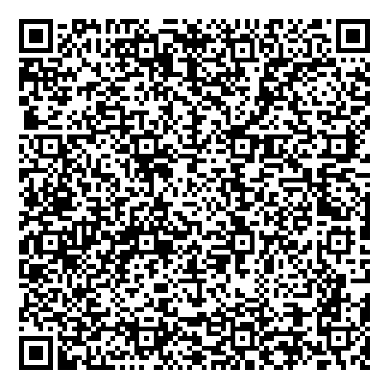

# Carta Astral

Aplicación que calcula tu carta natal y la explica en lenguaje claro: tríada (Sol, Luna y
Ascendente), decanatos, lado oscuro de cada signo, Lilith, Quirón, nodos lunares, planetas, casas,
aspectos, significado del nombre y numerología. Además: retorno solar (tu año) y lunar (tu mes),
compatibilidad con otra persona y un calendario con tus fechas importantes. Dibuja la rueda al
estilo del reloj astronómico de Praga, imprime un informe completo, puede leerte cada sección en voz
alta y tiene música de fondo.

Funciona sin internet y guarda todo en tu propio equipo. Sirve en Windows, en Linux y en el teléfono.

**¿Te sirvió?** Es gratis y lo seguirá siendo. Si quieres apoyarla, puedes hacerlo con CoDi:
[ver el código para escanear](#donaciones).

## Cómo descargarla y usarla

Es gratis, no pide crear cuentas y tus datos se quedan en tu computadora o en tu teléfono.

### En la computadora (Windows o Linux)

**Linux, lo más fácil:** en [la última versión](https://github.com/azgard69-69/carta-astral/releases/latest)
(sección **Releases**), descarga el archivo `Carta_Astral-…-x86_64.AppImage`. Dale permiso para ejecutarse (clic derecho → **Propiedades** →
**Permitir ejecutar como programa**) y ábrelo con doble clic. Usa el navegador que ya tengas instalado.

**Windows, o Linux sin AppImage:**

1. **Descárgala.** Arriba en esta página, pulsa el botón verde **Code** y luego **Download ZIP**.
2. **Descomprímela.**
   - Windows: clic derecho sobre el archivo descargado → **Extraer todo…** → **Extraer**.
   - Linux: clic derecho sobre el archivo → **Extraer aquí**.
3. **Ábrela.** Entra en la carpeta `carta-astral-main` que se acaba de crear:
   - **Windows:** doble clic en `index.html` (puede aparecer solo como `index`) y se abre en tu
     navegador. Para abrirla en su propia ventana, sin barras, usa `Abrir Carta Astral.bat`.
   - **Linux:** doble clic en `index.html`. Para abrirla en su propia ventana, abre una terminal
     en esa carpeta y escribe:

     ```bash
     ./abrir-linux.sh
     ```

     Para que aparezca en el menú de aplicaciones, `./instalar-linux.sh` (y para quitarla,
     `./instalar-linux.sh --quitar`).

Funciona sin internet. Usa un navegador actual: Chrome, Edge, Brave o Firefox.

**Sin descargar nada:** abre https://azgard69-69.github.io/carta-astral/ en Chrome, Edge o Brave
y pulsa el botón **Instalar** que aparece en la barra de direcciones. Queda como una aplicación más
de tu computadora.

### En el teléfono (Android o iPhone)

En el teléfono no se usa el ZIP: la app se abre desde su dirección web y se instala desde ahí.

1. Abre **https://azgard69-69.github.io/carta-astral/** en el navegador del teléfono.
2. Instálala:
   - **Android (Chrome):** menú **⋮** → **Instalar aplicación** o **Agregar a la pantalla principal**.
   - **iPhone (Safari):** botón **Compartir** (el cuadrado con la flecha hacia arriba) →
     **Agregar a inicio**.
3. Aparece el icono de Carta Astral junto a tus otras apps. La primera vez necesita internet;
   después funciona sin conexión.

### Primeros pasos

1. En **Mis datos**, escribe tu nombre y apellidos, tu fecha y hora de nacimiento, y empieza a
   escribir tu lugar de nacimiento hasta que aparezca en la lista; elígelo ahí. Si hay varios
   lugares con el mismo nombre, añade el estado o el país: «San José Chiapas».
2. Pulsa **Calcular mi carta**.
3. Recorre las secciones:
   - **Carta natal:** tu signo solar, lunar y Ascendente, la rueda, los planetas, Quirón, los nodos,
     las casas y los aspectos. Toca cualquier astro para leer más.
   - **Cielo de hoy:** dónde está cada astro ahora, qué toca en tu carta y tus fechas importantes de
     los próximos doce meses; **Pasar a mi calendario** las descarga al calendario del teléfono.
   - **Retornos:** cómo viene tu año (retorno solar) y tu mes (retorno lunar).
   - **Compatibilidad:** escribe los datos de otra persona para ver qué los une, dónde chocan y qué
     pueden cambiar o evitar.
   - **Cómo se lee:** la guía para entender todo lo anterior.
4. Con **Imprimir o guardar PDF** obtienes el informe completo.
5. Con **Escuchar** la app te lee la sección en voz alta, con las voces de tu equipo o teléfono
   (aparece si hay alguna voz en español).
6. La música empieza sola; se pausa desde el menú.

Si no sabes tu hora de nacimiento, marca **No conozco mi hora exacta**: verás todo menos el
Ascendente y las casas.

### Actualizarla

- **En la computadora:** descárgala de nuevo y sustituye la carpeta anterior.
- **En el teléfono:** se actualiza sola cuando la abres con internet.

Tus datos se guardan en el navegador, no en la carpeta. Si al cambiar de versión no aparecen,
vuelve a escribirlos: la carta se calcula en un momento.

## Compartirla

```bash
python3 herramientas/empaquetar.py
```

Deja en `distribuir/` un archivo `.zip` de unos 4 MB con solo lo necesario para usarla (sin las
herramientas ni las pruebas). Quien lo reciba lo descomprime y la abre como se explica arriba.

Para el AppImage de Linux hace falta el «runtime» oficial de AppImage
(https://github.com/AppImage/type2-runtime/releases, archivo `runtime-x86_64`) y `mksquashfs`:

```bash
python3 herramientas/hacer_appimage.py runtime-x86_64
```

Deja en `distribuir/` el archivo `Carta_Astral-<versión>-x86_64.AppImage`, de unos 4 MB. Al subir una
etiqueta `v<versión>` a GitHub, `.github/workflows/publicar.yml` lo arma solo y lo publica en Releases
junto con el `.zip`. No lleva
navegador dentro: al abrirlo copia la app a `~/.local/share/carta-astral/` y la abre con el
navegador del equipo.
La copia que se instala desde el navegador funciona sin conexión gracias a `manifest.webmanifest`
y `sw.js`.

## Imprimir o guardar en PDF

En la carta natal, pulsa **Imprimir o guardar PDF** (también vale Ctrl+P). Se abre el diálogo de
impresión del navegador con un informe completo en papel blanco, de unas diez páginas: la rueda,
la tríada con su lado oscuro, Lilith, cada planeta, las doce casas, todos los aspectos con cómo
usarlos, el nombre con sus números y la tabla de posiciones. Para obtener un PDF, elige
«Guardar como PDF» en el destino.

## Música de fondo

El reproductor está en el menú, debajo de «Mis datos». La música empieza encendida; **Pausar música** la detiene
y la app recuerda esa elección. El botón de al lado abre la melodía y el volumen. Los navegadores no
dejan sonar nada hasta el primer clic, así que a veces arranca al tocar la página.

Las cinco melodías no son archivos: la app las genera nota por nota, así que no pesan ni tienen
derechos de autor. Todas están afinadas con el la en 432 Hz.

1. **Gayatri mantra (flauta):** su entonación védica tradicional de tres notas, con flauta y tanpura.
2. **Om:** una voz grave que canta A-U-M en 108 Hz (dos octavas por debajo de 432).
3. **Cuencos:** cuencos que suenan de vez en cuando y se apagan despacio.
4. **Claro de luna (Beethoven):** los primeros compases de la sonata.
5. **Noche serena:** acordes lentos con algún destello agudo.

Con **Mi propia música…** puedes elegir canciones de tu equipo; no se copian ni se guardan dentro
de la app.

## Qué hay en cada carpeta

| Carpeta o archivo | Para qué sirve |
|---|---|
| `index.html` | La página de la aplicación. |
| `css/estilos.css` | Colores y diseño (índigo con brillantina dorada). |
| `js/astro.js` | El motor: calcula Sol, Luna, planetas, Lilith, Quirón, nodos, casas, aspectos, hora solar, retornos, tránsitos, eclipses y retrogradaciones. |
| `js/rueda.js` | Dibuja la rueda al estilo del reloj astronómico de Praga. |
| `js/musica.js` | La música de fondo. |
| `js/voz.js` | La lectura en voz alta. |
| `js/numerologia.js` | Camino de vida, expresión y alma. |
| `js/guia.js` | Los textos de la guía, convertidos para la app. **No se edita a mano.** |
| `js/textos.js` | Textos en lenguaje llano de planetas, casas, aspectos, nodos, Quirón, retornos, compatibilidad y calendario. Borrador; se edita a mano. |
| `js/nombres.js` | Significado de unos 1.240 nombres (español, inglés, náhuatl, maya y otros) y sus variantes de escritura. Borrador; se edita a mano. |
| `js/ciudades.js` | Lista propia de 119 ciudades, con sus nombres en español. |
| `js/ciudades-mundo.js` | Unas 170.000 ciudades y pueblos del mundo de más de 1.000 habitantes (GeoNames). **No se edita a mano.** |
| `js/app.js` | Une el formulario, los cálculos y los textos. |
| `letras/` | La letra cursiva de los títulos (Courgette) y su licencia. |
| `iconos/` | El icono de la app. |
| `imagenes/` | El código de CoDi para apoyar el proyecto. |
| `herramientas/` | Programas de apoyo: convertir la guía, las ciudades, dibujar el icono, empaquetar y armar el AppImage. |
| `pruebas/` | Comprobaciones de los cálculos y de la rueda. |
| `LICENSE` | El texto de la licencia GPL versión 3. |

## Si cambias la guía

Los textos de la tríada, los decanatos, las sombras y Lilith están en `js/guia.js`, que se genera
a partir de un documento `.odt` que no forma parte del repositorio. Si tienes ese documento,
ponlo en una carpeta `fuentes/` (Git no la sube) y ejecuta:

```bash
python3 herramientas/generar_guia.py "fuentes/El zodiaco completi.odt" js/guia.js
```

Las erratas que se corrigen al convertirla están en `herramientas/correcciones.json`.

## Comprobar los cálculos

```bash
node pruebas/prueba-motor.js
```

## Precisión y límites

- Fechas admitidas: de 1800 a 2050.
- Sol: menos de un segundo de arco (teoría VSOP87). Luna: unos 0,05°. Planetas: hasta 0,2° (Júpiter
  y Saturno son los menos exactos).
  Es suficiente para signo, decanato, casa y aspectos; un programa profesional afina más.
- Casas: sistema Placidus. Más allá de 66° de latitud se usan casas iguales.
- Lilith: Luna Negra media. Nodos lunares: nodos medios.
- Quirón: órbita del JPL; coincide en menos de 0,1° con sus entradas en signo de 2005 a 2026 y es
  aproximado lejos de esos años.
- Calendario: los eclipses se detectan por la distancia del Sol a los nodos en cada luna nueva o
  llena (coinciden con los de 2026 y 2027); las fechas de los tránsitos, con un margen de horas.
- Retorno solar: el momento exacto en que el Sol vuelve a su longitud natal (en el zodiaco tropical),
  con menos de un minuto de diferencia; se calcula para el lugar que elijas.
- Numerología pitagórica con la tabla en español (la Ñ vale 5). Los números 11, 22 y 33 no se
  reducen. Expresión y alma se calculan con nombre y apellidos.
- Las ciudades de la lista mundial llevan su nombre en GeoNames, que a veces está en inglés.

## Licencia

Carta Astral es software libre bajo la **Licencia Pública General de GNU, versión 3** (GPL v3).
Puedes usarla, copiarla, estudiarla, modificarla y compartirla; si repartes una versión
modificada, debe seguir siendo libre y con esta misma licencia. El texto completo está en `LICENSE`.

Copyright © 2026 Siddhartha Ajax

Origen de los textos: los de la tríada, decanatos, sombras y Lilith vienen de la «Guía Magna de
Astrología», una recopilación propia hecha con ayuda de inteligencia artificial (Gemini). Los demás
textos (planetas, casas, aspectos, nombres) son borradores escritos con ayuda de inteligencia
artificial (Claude). Es astrología tradicional, no consejo profesional.

Partes que conservan su propia licencia:

- **Ciudades:** GeoNames (https://www.geonames.org), Creative Commons Atribución 4.0.
- **Letra Courgette:** Sorkin Type Co, SIL Open Font License 1.1 (`letras/OFL.txt`).
- **Texto de la licencia GPL:** Free Software Foundation.

## Donaciones

La app es gratuita y lo seguirá siendo. Si te sirvió y quieres apoyarla, puedes hacerlo con CoDi
desde la app de tu banco (solo bancos de México):



## Pruebas con personas

En las pruebas de las versiones beta, personas elegidas al azar revisaron su carta natal: se
quedaron sorprendidas, emocionadas y cautivadas, y hubo quienes se asustaron al verla.

## Pendiente

- Que alguien que sepa de astrología revise los borradores de `js/textos.js` y `js/nombres.js`.
- Probar `Abrir Carta Astral.bat` en un Windows de verdad (se escribió sin poder probarlo;
  `index.html` funciona igual).
- Un instalador `.exe` para Windows (el AppImage de Linux ya existe).
